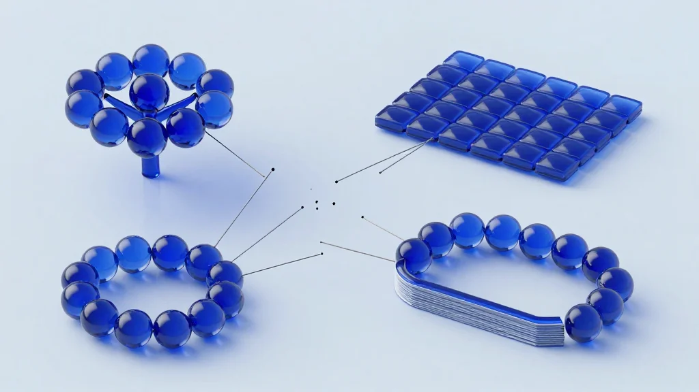

# Tenniarb: diagrams, screens and documentation that compute

Russian version: [readme.ru.md](readme.ru.md)

Tenniarb is a desktop app for models you draw by hand: mind maps and diagrams, UI screens assembled from
components, and the documentation that belongs next to them. A model is one `.tenn` file — plain text,
readable and editable by hand, with JavaScript expressions inside.


## The problem I'm solving

A single model rarely stays in one tool:

- the structure is drawn in a mind-mapping app,
- the numbers are recalculated in a spreadsheet,
- the screens are drawn in a design tool,
- the explanation is written in a document,
- and every one of them drifts as soon as something changes.

The picture is right in one place, the numbers in another, and nobody knows which copy is the current one.



## What Tenniarb does

One file, one app, four kinds of content:


**Structure** — a tree of elements and items, drawn as a diagram: nodes, links, styles, their own
positions and sizes.

**Calculation** — any property can be a JavaScript expression. Change a value and everything that depends
on it recalculates; the render shows the result, not the formula.

**Screens** — an element can also be a UI scene: components with parameters, styles and slots, auto-layout,
animations. A component is written once and used with different values.

**Text** — a documentation page is an item with a markdown body: headings, lists, code, tables, and a table
of contents built from those headings. Links go to a heading of another file and survive the clone.

All of it is `.tenn`: diffable, reviewable, and a `git diff` shows what actually changed.

## Who is it for

### Analysts and planners
Forecasts, budgets and models where the hierarchy is as important as the arithmetic.

### Product managers and designers
Screens and flows kept beside the numbers and the notes, in one repository instead of three.

### Engineers and researchers
Multi-level system models with live calculations for scenario analysis.

### Teams that document what they build
Documentation as a graph of pages, headings and cross-links — in the same repository as the design.

### Agents
The same files are read, edited and rendered by MCP tools, so an agent works on a model you can see.

## Key features

**🏗️ Hierarchical modeling**
Trees of any depth; every item is an object with properties, some of them computed.

**🧮 Live expressions**
`${…}` is evaluated per element — in a title, a size, a style name, an animation frame. `value 3` and
`title "Open: ${value}"` is all it takes.

**🧩 Components and libraries**
`kind Component`, `export let` parameters with defaults, named styles, slots, `use … as …` with overrides.
A library is an ordinary `.tenn` file.

**🎨 Scenes, not just boxes**
Auto-layout (row, column, grid), corner radii, shadows, gradients, clipping, animation frames the editor plays.

**📄 Documentation as a graph**
`body` holds markdown that hugs its content; `toc` builds a table of contents; a link to `other.tenn#Heading`
opens the file at that heading.

**📦 Exports**
PNG, SVG, HTML with the image inside, interactive HTML that draws the model in a browser without the app,
and pages: every element as a PNG or as a page of one PDF.

**🕵️ Git compare**
A tree of what changed between the file and `HEAD` — added, removed, changed, moved, with the old and the
new value — and Revert as one undo step.

**🌍 macOS, Windows, Linux**
One Go application, the same renderer and the same files everywhere. The browser bundle draws a `.tenn`
inside a web page.

**🤖 For agents**
MCP tools read state, edit, validate and render; the CLI validates (`check`), tidies (`suggest`), flattens
mounted files (`bundle`) and prints generated text (`gen`).

## What a file looks like

A component with a parameter, a style picked by a value, and a documentation block:

```tenn
element "Cards" {
  item Card {
    kind Component
    export let title = "Untitled"
    export let tone = neutral
    styles {
      neutral { color #f3f4f6; text-color #111827 }
      urgent  { color #fee2e2; text-color #7f1d1d }
      tone one-of neutral urgent
    }
    item Box {
      auto-layout column
      width 220
      use-style ${tone}
      item Label { title ${title}; font-size 14 }
      item Note  { body "Created by the intake bot" }
    }
  }

  use Card as first { title "Nobody picked up the call"; tone urgent }

  item "How it works" {
    auto-layout column
    width 640
    body %{
## Goal
Bring the call to payment.

- a hold by an idempotent key
- the queue is PostgreSQL: `SKIP LOCKED`
    }
  }
}
```

## Use cases

**Financial planning** — revenue by department as a tree; change an assumption and the totals follow.

**Project estimation** — phases, typical costs, risk buffers as expressions; one look at the whole picture.

**Scenario analysis** — a decision tree where each branch carries its own numbers.

**Interface design** — screens assembled from components, kept in the same repository as the model and the
notes, reviewed as text.

**Documentation** — pages with headings, table of contents and cross-links, exported as a PDF or a single
HTML file.

## Why Tenniarb, not other tools?

| | Tenniarb | Excel | Mind map apps | Design tools |
|---|---|---|---|---|
| **Visual hierarchy** | ✅ Natural | ⚠️ Cells and references | ✅ Excellent | ⚠️ Frames |
| **Calculations** | ✅ JavaScript in any property | ✅ Yes | ❌ No | ❌ No |
| **Screens and components** | ✅ Yes | ❌ No | ❌ No | ✅ Yes |
| **Text and documentation** | ✅ Markdown, TOC, links | ⚠️ Cells of text | ⚠️ Notes on nodes | ⚠️ Separate docs |
| **Files in Git** | ✅ Plain text, comparable | ⚠️ Binary | ⚠️ Mostly proprietary | ⚠️ Binary |
| **Agents can edit it** | ✅ MCP and CLI | ❌ | ❌ | ⚠️ Limited |

Tenniarb is not a replacement for Excel or for a design tool. It is one place for a model whose structure,
numbers and text belong together.

## Tech stack

- **Go** with the `gowt` toolkit — one native application for macOS, Windows and Linux.
- **JavaScript expressions** — evaluated by an embedded engine; the same expressions in the app and in the browser.
- **TypeScript renderer** for the browser (`web/`), checked against the Go renderer by golden tests, so a
  page looks the same in the app and on the web.
- **`.tenn`** — a plain-text format with its own lexer, parser and printer in both implementations.

## Get started

Download a build from [Releases](https://github.com/haiodo/tenniarb/releases):

- macOS, Apple silicon — `Tenniarb-<version>-arm64.dmg`
- Windows — `tenniarb-<version>-windows-amd64.zip`
- Linux — `tenniarb-<version>-linux-amd64.tar.gz`

The builds are unsigned: macOS asks to allow the app in Security, Windows shows a SmartScreen warning.
Open `docs/Example.tenn` to see a file with diagrams and markdown bodies.

Under the hood: `make app` builds the app for this machine, `make test` runs the Go and web tests,
`make install` puts it into `/Applications` along with the CLI and the MCP proxy.

Documentation: [`docs/`](docs/) — general information, links, MCP, examples and the
[changelog](docs/Changelog.md).

Source: [github.com/haiodo/tenniarb](https://github.com/haiodo/tenniarb), [Eclipse Public License 2.0](LICENSE).

## Vision

People think in hierarchies and relationships, not in tables, and not in four disconnected applications.
Tenniarb keeps the picture, the numbers and the words in one file that you can read, diff and hand to an
agent — so the model and its explanation cannot drift apart.

**Welcome to Tenniarb.**
