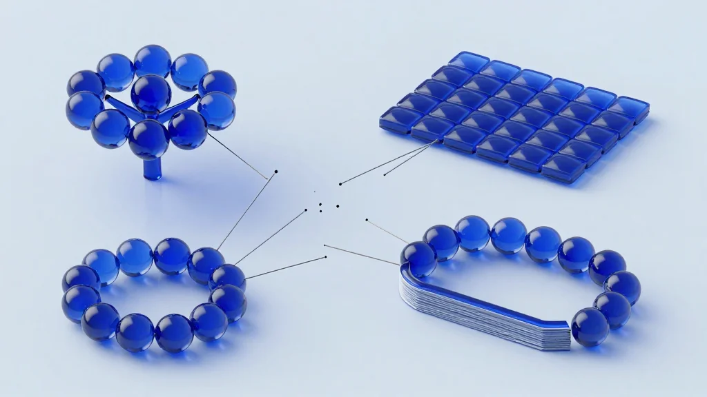

# Tenniarb: диаграммы, экраны и документация, которые считают

English version: [readme.md](readme.md)

Tenniarb — настольное приложение для моделей, которые рисуют руками: интеллект-карт и диаграмм, экранов
интерфейса, собранных из компонентов, и документации, которая живёт рядом с ними. Модель — это один файл
`.tenn`: обычный текст, который можно читать и править вручную, с выражениями на JavaScript внутри.


## Проблему, которую я решаю

Одна модель редко помещается в один инструмент:

- структура нарисована в приложении для майндмэппинга,
- числа пересчитаны в таблице,
- экраны нарисованы в редакторе дизайна,
- объяснение написано в документе,
- и все четыре расходятся, как только что-то меняется.

Картинка верна в одном месте, числа — в другом, и никто не знает, какая копия актуальна.



## Что делает Tenniarb

Один файл, одно приложение, четыре вида содержимого:


**Структура** — дерево элементов и узлов, нарисованное как диаграмма: узлы, связи, стили, собственные
позиции и размеры.

**Расчёт** — любое свойство может быть выражением на JavaScript. Меняете значение — пересчитывается всё,
что от него зависит; на холсте виден результат, а не формула.

**Экраны** — элемент может быть и сценой интерфейса: компоненты с параметрами, стилями и слотами,
авто-раскладка, анимации. Компонент пишется один раз и используется с разными значениями.

**Текст** — страница документации это узел с markdown-телом: заголовки, списки, код, таблицы и оглавление,
собранное из этих заголовков. Ссылка ведёт на заголовок другого файла и переживает клонирование.

Всё это `.tenn`: сравнивается, рецензируется, и `git diff` показывает, что именно изменилось.

## Для кого это

### Аналитики и планировщики
Прогнозы, бюджеты и модели, где иерархия важна не меньше арифметики.

### Продакты и дизайнеры
Экраны и сценарии рядом с числами и заметками — в одном репозитории вместо трёх.

### Инженеры и исследователи
Многоуровневые модели систем с живыми расчётами для анализа сценариев.

### Команды, которые документируют то, что делают
Документация как граф страниц, заголовков и перекрёстных ссылок — в том же репозитории, что и дизайн.

### Агенты
Те же файлы читают, правят и рисуют MCP-инструменты, так что агент работает с моделью, которую видно:
файл, который он правит, открывается в окне с включённым Follow.

## Возможности

**🏗️ Иерархическое моделирование**
Деревья любой глубины; каждый узел — объект со свойствами, часть из которых вычисляется.

**🧮 Живые выражения**
`${…}` вычисляется для каждого элемента — в заголовке, размере, имени стиля, кадре анимации. Достаточно
`value 3` и `title "Open: ${value}"`.

**🧩 Компоненты и библиотеки**
`kind Component`, параметры `export let` с умолчаниями, именованные стили, слоты, `use … as …` с
переопределениями. Библиотека — обычный файл `.tenn`.

**🎨 Сцены**
Авто-раскладка (строка, колонка, сетка), скругления, тени, градиенты, обрезка, кадры анимации, которые
проигрывает редактор.

**📄 Документация как граф**
В `body` лежит markdown, который подстраивает высоту под содержимое; `toc` собирает оглавление; ссылка на
`other.tenn#Заголовок` открывает файл на этом заголовке.

**📦 Экспорт**
PNG, SVG, HTML с картинкой внутри, интерактивный HTML, который рисует модель в браузере без приложения, и
страницы: каждый элемент отдельным PNG или страницей одного PDF.

**🕵️ Сравнение с Git**
Дерево изменений между файлом и `HEAD` — добавлено, удалено, изменено, перемещено, со старым и новым
значением — и Revert одной операцией отмены.

**🌍 macOS, Windows, Linux**
Одно приложение на Go, один и тот же рендерер и одни и те же файлы везде. Бандл для браузера рисует `.tenn`
прямо на веб-странице.

**🤖 Для агентов**
MCP-инструменты читают состояние, правят, проверяют и рисуют; CLI проверяет (`check`), подчищает
(`suggest`), разворачивает подключённые файлы (`bundle`) и печатает сгенерированный текст (`gen`).

## Как выглядит файл

Компонент с параметром, стиль по значению и блок документации:

```tenn
element "Cards" {
  item Card {
    kind Component
    export let title = "Untitled"
    export let tone = neutral
    styles {
      neutral { color #f3f4f6; text-color #111827 }
      urgent  { color #fee2e2; text-color #7f1d1d }
      tone one-of neutral urgent
    }
    item Box {
      auto-layout column
      width 220
      use-style ${tone}
      item Label { title ${title}; font-size 14 }
      item Note  { body "Создано ботом приёма заявок" }
    }
  }

  use Card as first { title "Звонок никто не взял"; tone urgent }

  item "Как это работает" {
    auto-layout column
    width 640
    body %{
## Цель
Довести звонок до оплаты.

- удержание по идемпотентному ключу
- очередь на PostgreSQL: `SKIP LOCKED`
    }
  }
}
```

## Примеры

**Финансовое планирование** — выручка по отделам деревом; меняете допущение — итоги следуют за ним.

**Оценка проектов** — фазы, типовые затраты, риск-буферы выражениями; вся картина на одном экране.

**Анализ сценариев** — дерево решений, где у каждой ветви свои числа.

**Дизайн интерфейса** — экраны из компонентов в одном репозитории с моделью и заметками, рецензия — как
рецензия текста.

**Документация** — страницы с заголовками, оглавлением и перекрёстными ссылками, экспорт в PDF или один
HTML-файл.

## Почему Tenniarb, а не другие инструменты?

| | Tenniarb | Excel | Майндмэп | Редакторы дизайна |
|---|---|---|---|---|
| **Визуальная иерархия** | ✅ Естественная | ⚠️ Ячейки и ссылки | ✅ Отличная | ⚠️ Фреймы |
| **Расчёты** | ✅ JavaScript в любом свойстве | ✅ Да | ❌ Нет | ❌ Нет |
| **Экраны и компоненты** | ✅ Да | ❌ Нет | ❌ Нет | ✅ Да |
| **Текст и документация** | ✅ Markdown, оглавление, ссылки | ⚠️ Ячейки текста | ⚠️ Заметки на узлах | ⚠️ Отдельные документы |
| **Файлы в Git** | ✅ Текст, сравнивается | ⚠️ Бинарный | ⚠️ Обычно закрытый формат | ⚠️ Бинарный |
| **Агент может править** | ✅ MCP и CLI | ❌ | ❌ | ⚠️ Ограниченно |

Tenniarb не заменяет Excel и не заменяет редактор дизайна. Это одно место для модели, у которой структура,
числа и текст должны быть вместе.

## Технический стек

- **Go** и тулкит `gowt` — одно нативное приложение для macOS, Windows и Linux.
- **Выражения на JavaScript** — считает встроенный движок; те же выражения в приложении и в браузере.
- **Рендерер на TypeScript** для браузера (`web/`), сверенный с рендерером на Go golden-тестами, поэтому
  страница выглядит одинаково в приложении и в вебе.
- **`.tenn`** — текстовый формат со своими лексером, парсером и принтером в Go и в TypeScript.

## Начните прямо сейчас

Скачайте сборку из [Releases](https://github.com/haiodo/tenniarb/releases):

- macOS, Apple silicon — `Tenniarb-<version>-arm64.dmg`
- Windows — `tenniarb-<version>-windows-amd64.zip`
- Linux — `tenniarb-<version>-linux-amd64.tar.gz`

Сборки без подписи: macOS попросит разрешить приложение в разделе «Безопасность», Windows покажет
предупреждение SmartScreen. Откройте `docs/Example.tenn` — там диаграммы и markdown-тела.

Для разработки: `make app` собирает приложение для этой машины, `make test` гоняет тесты Go и web,
`make install` ставит его в `/Applications` вместе с CLI и MCP-прокси.

Документация: [`docs/`](docs/) — общее описание, ссылки, MCP, примеры и [changelog](docs/Changelog.md).

Исходники: [github.com/haiodo/tenniarb](https://github.com/haiodo/tenniarb), [Eclipse Public License 2.0](LICENSE).

## Видение

Люди думают иерархиями и связями, а не таблицами и не четырьмя несвязанными приложениями. Tenniarb держит
картинку, числа и слова в одном файле, который можно прочитать, сравнить и отдать агенту, — чтобы модель и
её объяснение не расходились.

**Добро пожаловать в Tenniarb.**
